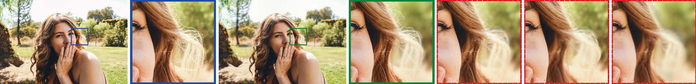
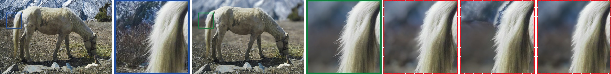
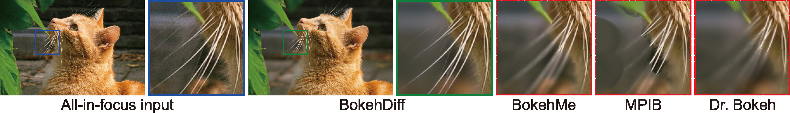

# BokehDiff: Neural Lens Blur with One-Step Diffusion





- A physics-inspired self-attention (PISA) module design that aligns with the image formation process, incorporating depth-dependent circle of confusion constraint and self-occlusion effects. 
- A one-step inference scheme to exploit the diffusion prior, without introducing additional noise.
- A scalable paired data synthesis scheme, combining AIGC photorealistic foregrounds with transparency and conventional all-in-focus background images, balancing authenticity and scene diversity.

[[Paper](https://drive.google.com/file/d/1CYNf7-HTmwdLbW4rjnDUqg6o62MLN-TL/view?usp=sharing)]

The dataset synthesis is now performed on-the-fly, which means it only needs to take foreground images (with transparency) and background images as input, and the images with lens blur will be generated in `dataset.py` in parallel with training.

## Prerequisites

- **Python 3.10** (the conda environment is created with 3.10).
- **One NVIDIA GPU** with CUDA support. At least ~10 GB VRAM for 512x512 inference (the pipeline loads SDXL-class weights). 24 GB is recommended for training.
- **Linux** is strongly recommended. xformers and cupy have limited or no Windows/macOS CUDA support.
- **Network access** on first run: several HuggingFace models are auto-downloaded (see [Models downloaded on first run](#models-downloaded-on-first-run) below).

## Quick start

### 1. Create the conda environment

```bash
conda create -n bokehdiff python=3.10 pytorch torchvision pytorch-cuda=12.1 \
    peft transformers kornia pillow scikit-image piq lpips accelerate \
    safetensors cupy xformers \
    -c pytorch -c nvidia -c conda-forge
conda activate bokehdiff
```

> **Why `pytorch-cuda=12.1`?** Pinning `pytorch-cuda` ensures conda installs a CUDA-enabled PyTorch from the `pytorch` channel.  Adjust `12.1` to match your driver (run `nvidia-smi` to check; use `11.8` for older drivers).

### 2. Install vision-aided-loss

```bash
cd vision-aided-gan-main; pip install -e . ; cd ..
```

This installs the `vision_aided_loss` package (used for GAN discriminator training loss).

### 3. Install diffusers (pinned version)

```bash
pip install diffusers==0.32.1
```

> **Important:** `diffusers==0.32.1` is the tested version. Other versions may produce `AttributeError` or API changes that break the pipeline. If pip tries to upgrade/downgrade `torch` or `transformers` as a dependency of diffusers, use `pip install diffusers==0.32.1 --no-deps` instead, then manually install any genuinely missing sub-dependency.

### 4. (Optional) Fix torch if conda install was incomplete

The original setup included a `uv pip install torch torchvision` step. This is only needed if, after the steps above, `python -c "import torch; print(torch.cuda.is_available())"` prints `False`. In that case:

```bash
pip install uv
uv pip install torch torchvision
```

> **Caution:** Running this unconditionally can silently replace the conda-installed PyTorch with a CPU-only or differently-versioned build, breaking xformers and cupy CUDA compatibility. Only run it if the conda torch is non-functional.

### 5. Verify the installation

```bash
python -c "import torch, diffusers, xformers, cupy, peft, transformers; \
    print('torch', torch.__version__, 'cuda', torch.cuda.is_available()); \
    print('diffusers', diffusers.__version__)"
```

Expected: `torch 2.x.x cuda True` and `diffusers 0.32.1`.

---

## Data preparation

`prepare_data.py` runs [Depth-Anything-V2](https://github.com/DepthAnything/Depth-Anything-V2) and [BiRefNet](https://github.com/ZhengPeng7/BiRefNet) to produce depth maps and salient-object masks for your input images.

### Expected folder layout

```
test_data/
  input/          # Place your input images here (common image formats supported)
    photo1.jpg
    photo2.jpg
```

### Run

```bash
python prepare_data.py
```

After completion the folder will look like:

```
test_data/
  input/
    photo1.jpg
    photo2.jpg
  depth/
    photo1_pred.npy    # disparity map (float32 numpy array)
    photo2_pred.npy
  mask/
    photo1.png         # salient-object mask (uint8 grayscale)
    photo2.png
```

Input images in common formats (`.jpg`, `.jpeg`, `.png`) are supported.

Optional flags:
- `--root <dir>` (default: `test_data`) -- root directory.
- `--model_size {Small,Base,Large}` (default: `Base`) -- Depth-Anything-V2 model size.

---

## Inference

```bash
python inference_hf.py \
    --test_data_dir "test_data/input/*" \
    --output_dir bokehdiff_test \
    --enable_xformers_memory_efficient_attention \
    --data_id demo \
    --K 20
```

The script renders the prepared data and saves results to `bokehdiff_test/demo/`, with a bokeh strength of 20.

### Key arguments

| Argument | Default | Description |
|----------|---------|-------------|
| `--test_data_dir` | (required) | Glob pattern for input images, e.g. `"test_data/input/*"`. |
| `--output_dir` | `bokehdiff_outputs` | Top-level output directory. |
| `--data_id` | (required) | Subfolder name under `output_dir` for this run's results. |
| `--K` | `20` | Bokeh strength. Larger values produce stronger blur. |
| `--upsample` | `1` | Upsample factor applied to input before rendering in latent space. |
| `--mixed_precision` | `no` | `no`, `fp16`, or `bf16`. Use `fp16`/`bf16` to reduce VRAM usage. |
| `--enable_xformers_memory_efficient_attention` | off | Enable xformers memory-efficient attention (recommended). |
| `--seed` | `None` | Random seed for reproducibility. |
| `--resume_from_checkpoint` | `None` | Path to a local checkpoint directory (skips HF download). |
| `--organization` | `EBB` | Dataset file organization. Use `EBB` for the default `input/`+`depth/`+`mask/` layout. |

For each input image, three output images are saved with different focal-plane shifts (foreground-focused, mid, background-focused).

---

## Training

For training, foreground data with transparency is needed, to synthesize the image with lens blur effects on-the-fly. I'll provide more details about this part when I have more spare time. 😢

If you already have some data in hand, you can place the foreground (PNG files w/transparency) and background (ordinary images, all-in-focus) in two folders of `<data_root>/fg/` and `<data_root>/bg/`. You should specify `<data_root>` when running the training script:

### Training data layout

```
<data_root>/
  fg/             # Foreground images (PNG with alpha/transparency channel)
    subject1.png
    subject2.png
    ...
  bg/             # Background images (all-in-focus, any common format)
    scene1.jpg
    scene2.jpg
    ...
```

The `fg/` directory can contain subdirectories -- the dataset code globs `<data_root>/*fg/*`.

### Run

```bash
mkdir logs_bokehdiff
python train_lora_otf.py --train_data_dir <data_root> \
--pretrained_model_name_or_path SG161222/RealVisXL_V5.0 \
--train_batch_size 1 --output_dir logs_bokehdiff \
--mixed_precision no --opt_vae 1 \
--max_train_steps 120000 --enable_xformers_memory_efficient_attention \
--learning_rate 5e-5 --lr_scheduler cosine --lr_num_cycles 1 \
--lr_warmup_steps 20 --resolution 512 \
--lpips --edge --lambda_lpips 5 --checkpointing_steps 60000 \
--gan_loss_type multilevel_sigmoid_s --cv_type convnext \
--lambda_gan 0.1 --gan_step 30000
```

Multi-GPU training is supported via `accelerate`:
```bash
accelerate launch train_lora_otf.py --train_data_dir <data_root> ...
```

---

## Models downloaded on first run

The following HuggingFace models are automatically downloaded on first use. Ensure you have network access and sufficient disk space (~25 GB total).

| Model | Used by | Approximate size |
|-------|---------|-----------------|
| [`depth-anything/Depth-Anything-V2-Base-hf`](https://huggingface.co/depth-anything/Depth-Anything-V2-Base-hf) | `prepare_data.py` (depth estimation) | ~400 MB |
| [`ZhengPeng7/BiRefNet`](https://huggingface.co/ZhengPeng7/BiRefNet) | `prepare_data.py` (salient mask) | ~900 MB |
| [`SG161222/RealVisXL_V5.0`](https://huggingface.co/SG161222/RealVisXL_V5.0) | `inference_hf.py`, `train_lora_otf.py` (base SDXL model) | ~13 GB |
| [`zcx65535/bokehdiff`](https://huggingface.co/zcx65535/bokehdiff) | `inference_hf.py` (LoRA weights + VAE checkpoint) | ~200 MB |

Models are cached in your HuggingFace cache directory (`~/.cache/huggingface/hub/` by default). Set `HF_HOME` to change the cache location.

---

## Troubleshooting

### xformers complains about torch version / fails to import

xformers must match your PyTorch version exactly. After installing, verify:
```bash
python -c "import xformers; import torch; print(xformers.__version__, torch.__version__)"
```
If they are mismatched, reinstall xformers for your torch version:
```bash
pip install xformers --index-url https://download.pytorch.org/whl/cu121
```
(Replace `cu121` with your CUDA version, e.g. `cu118`.)

### cupy import fails (`ModuleNotFoundError` or CUDA error)

cupy must match your CUDA toolkit version. If `import cupy` fails:
```bash
# For CUDA 12.x:
pip install cupy-cuda12x
# For CUDA 11.x:
pip install cupy-cuda11x
```

### `diffusers` AttributeError or import error

Stick to `diffusers==0.32.1`. Other versions may rename or remove APIs used by BokehDiff's custom pipeline code:
```bash
pip install diffusers==0.32.1
```

### Slow or failed HuggingFace downloads

Set `HF_ENDPOINT=https://hf-mirror.com` (or another mirror) if the default HuggingFace CDN is slow or blocked in your region. Use `HF_HUB_ENABLE_HF_TRANSFER=1` with `pip install hf-transfer` for faster downloads.

### `uv pip install torch torchvision` broke my environment

If PyTorch was replaced with a CPU-only or wrong-CUDA build, reinstall via conda:
```bash
conda install pytorch torchvision pytorch-cuda=12.1 -c pytorch -c nvidia
```
Then verify `torch.cuda.is_available()` returns `True`.

---

## Citation

If you find our work useful to your research, please cite our paper as:
```
@inproceedings{zhu2025bokehdiff,
  title = {BokehDiff: Neural Lens Blur with One-Step Diffusion},
  author = {Zhu, Chengxuan and Fan, Qingnan and Zhang, Qi and Chen, Jinwei and Zhang, Huaqi and Xu, Chao and Shi, Boxin},
  booktitle = {IEEE International Conference on Computer Vision},
  year = {2025}
}
```
Feel free to [contact me](https://freebutuselesssoul.github.io/) if you're also interested in the possibility of combining AIGC with photography.
